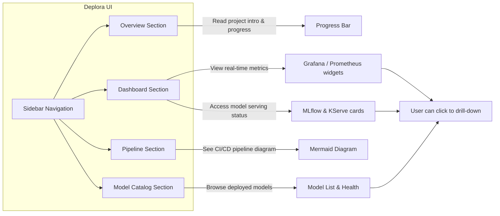

# Deplora – MLOps Platform

---

## 🎯 Project Vision & Goal
Deplora is a **single‑page, React‑based demonstration UI** that visualises a complete MLOps workflow from source‑code to model serving and monitoring. It is designed for:

- **Learning** – new engineers can see how code, CI/CD, containerisation, KServe, Argo CD and Grafana interact.
- **Documentation** – a living, interactive reference that can be bundled with a real deployment.
- **Rapid prototyping** – replace placeholder URLs with real services and instantly get a dashboard for your ML platform.

The name **Deplora** stands for **“Deployment + Exploration + Orchestration”**.

---

## 🛠️ Technical Stack
| Layer | Technologies |
|-------|--------------|
| **Frontend** | React 18, Vite 8, **lucide‑react** icons, CSS custom properties (`--primary`, `--text-muted`, …) |
| **Build / Bundling** | Vite (esbuild under the hood) – `npm run dev` for hot‑module reload, `npm run build` for production bundle |
| **CI / CD** | GitHub Actions (`.github/workflows/ci.yml`), Docker, **Argo CD**, **KServe**, **Grafana**, **Prometheus** |
| **Container Registry** | Docker Hub, Amazon ECR, GCR – configurable via secrets |
| **Orchestration** | Kubernetes (any cluster, e.g., EKS, GKE, Kind) |
| **Optional Rendering** | `react‑mermaid2` for live Mermaid diagrams (currently optional) |

---

## 📁 Repository Layout (relevant folders)
```text
/deplora                       ← repository root
│   README.md                 ← (this file after you run the next step)
│   uv.lock
│
├─ .github
│   └─ workflows
│       └─ ci.yml            ← CI pipeline definition
│
├─ components
│   └─ dashboard-ui           ← The Deplora React UI
│       ├─ index.html        ← HTML entry point – title set to "Deplora – MLOps Platform"
│       ├─ package.json
│       └─ src
│           ├─ main.jsx      ← React entry, mounts <App/> inside <BrowserRouter>
│           ├─ App.jsx       ← Shell: Sidebar + Header + AllInOne page (no router)
│           ├─ components
│           │   ├─ Sidebar.jsx        ← Navigation buttons with smooth scrolling
│           │   ├─ Header.jsx         ← Branding + action icons (Bell, Settings, user avatar)
│           │   └─ ProgressBar.jsx    ← Re‑usable bar showing % completion
│           └─ pages
│               ├─ AllInOne.jsx      ← Single scrollable page that aggregates all sections
│               ├─ ProjectOverview.jsx← Project intro, progress bar, quick‑start guide
│               ├─ Dashboard.jsx      ← Metric widgets + tool‑cards linking to external services
│               ├─ Deployments.jsx    ← Placeholder – can be filled with real deployment info
│               ├─ Infrastructure.jsx ← Placeholder – can show cluster health, node list, etc.
│               └─ Pipeline.jsx       ← Detailed description of the CI/CD + MLOps pipeline
│
└─ presentation-site          ← Another UI (not used by Deplora) – kept for completeness
```

---

## 📦 Implemented Features (with brief code excerpts)

### 1. Core Application Shell – `src/App.jsx`
```tsx
import React from 'react';
import Sidebar from './components/Sidebar';
import Header from './components/Header';
import AllInOne from './pages/AllInOne';

function App() {
  return (
    <div className="app-container">
      <Sidebar />
      <main className="main-content">
        <Header />
        <AllInOne />
      </main>
    </div>
  );
}
export default App;
```
*No router is used – the UI is a single page. All navigation is handled by the sidebar scrolling.*

### 2. Smooth‑Scroll Sidebar – `src/components/Sidebar.jsx`
```tsx
const scrollTo = (id) => () => {
  const el = document.getElementById(id);
  if (el) el.scrollIntoView({ behavior: 'smooth' });
};
...
<div onClick={scrollTo('overview')} style={navLinkStyle}>Overview</div>
<div onClick={scrollTo('dashboard')} style={navLinkStyle}>Dashboard</div>
<div onClick={scrollTo('deployments')} style={navLinkStyle}>Deployments</div>
<div onClick={scrollTo('infrastructure')} style={navLinkStyle}>Infrastructure</div>
<div onClick={scrollTo('pipeline')} style={navLinkStyle}>Pipeline</div>
```
*Each button scrolls to the corresponding `<section id="...">` in `AllInOne.jsx`.*

### 3. Progress Bar – `src/components/ProgressBar.jsx`
```tsx
const ProgressBar = ({ percent, label }) => {
  const safe = Math.min(Math.max(percent, 0), 100);
  return (
    <div>
      {label && <div>{label}</div>}
      <div style={trackStyle}>
        <div style={{ ...fillStyle, width: `${safe}%` }} />
      </div>
      <div>{safe}%</div>
    </div>
  );
};
```
*Used by `ProjectOverview.jsx` to display overall completion based on `src/data/completion.json`.*

### 4. Project Overview – `src/pages/ProjectOverview.jsx`
Shows a short description, the progress bar, and a **quick‑start checklist** (npm install, dev server, navigation, update `completion.json`).

### 5. Dashboard – `src/pages/Dashboard.jsx`
Displays three metric widgets (active models, CPU usage, API requests) and a list of tool cards linking to external services (MLflow, ArgoCD, Grafana, KServe, Argo Workflows).

### 6. All‑in‑One Page – `src/pages/AllInOne.jsx`
```tsx
<div style={container}>
  <section id="overview"><ProjectOverview /></section>
  <section id="dashboard"><Dashboard /></section>
  <section id="deployments"><Deployments /></section>
  <section id="infrastructure"><Infrastructure /></section>
  <section id="pipeline"><Pipeline /></section>
</div>
```
*Provides a single scrollable document, ideal for demos or documentation PDFs.*

### 7. Pipeline Overview – `src/pages/Pipeline.jsx`
* Uses a **static Mermaid‑style diagram** rendered as plain text to avoid runtime errors. The diagram string is stored in `diagram` constant.
* Provides a **step‑by‑step narrative**, instructions for connecting a personal GitHub repo, and how to wire model artifacts.
* Optional rendering instructions are included – install `react‑mermaid2` and replace the `<pre>` with `<Mermaid chart={diagram} />`.

---

## 🏗️ CI/CD Pipeline – `.github/workflows/ci.yml`
```yaml
name: CI
on: [push, pull_request]
jobs:
  build:
    runs-on: ubuntu-latest
    steps:
      - uses: actions/checkout@v3
      - name: Set up Node
        uses: actions/setup-node@v4
        with:
          node-version: '20'
      - name: Install deps
        run: npm ci
      - name: Build UI
        run: npm run build   # produces ./dist
      - name: Build Docker image
        run: |
          docker build -t ${{ secrets.DOCKER_REGISTRY }}/deplora-ui:${{ github.sha }} .
      - name: Push image
        env:
          REGISTRY_USER: ${{ secrets.REGISTRY_USER }}
          REGISTRY_PASSWORD: ${{ secrets.REGISTRY_PASSWORD }}
        run: |
          echo "$REGISTRY_PASSWORD" | docker login ${{ secrets.DOCKER_REGISTRY }} -u $REGISTRY_USER --password-stdin
          docker push ${{ secrets.DOCKER_REGISTRY }}/deplora-ui:${{ github.sha }}
      - name: Deploy via Argo CD (optional)
        if: github.ref == 'refs/heads/main'
        env:
          KUBECONFIG: ${{ secrets.KUBECONFIG }}
        run: |
          # Assuming you have Argo CD CLI installed in the runner image
          argocd login argocd.mycompany.com --insecure --username admin --password ${{ secrets.ARGO_PASSWORD }}
          argocd app sync deplora-ui
```
**Key Secrets** (must be added in the repository settings):
* `DOCKER_REGISTRY` – e.g., `docker.io/youruser` or `123456789012.dkr.ecr.us-east-1.amazonaws.com`.
* `REGISTRY_USER` / `REGISTRY_PASSWORD` – Docker registry credentials.
* `KUBECONFIG` – Base64‑encoded kubeconfig for the target cluster (used by Argo CD to apply manifests).
* `ARGO_PASSWORD` – Argo CD admin password (optional, for demo). 

The workflow builds the React UI, bundles it, creates a Docker image, pushes it, and optionally triggers a sync with Argo CD.

---

## 🤖 Model Integration Workflow
1. **Place your trained artifact** in the repository root under `models/` (e.g., `models/my_model.onnx`).
2. **Update the Dockerfile** (located in the repo root or `components/dashboard-ui/Dockerfile` – not shown here) to copy `models/` into the image and set the entrypoint for KServe.
3. **CI Step** – The Docker build step automatically includes the model file.
4. **KServe Manifest** – A typical `kserve.yaml` would reference the image tag `${{ github.sha }}` so the freshly‑built model image is served.
5. **UI Consumption** – Once deployed, the endpoint `/v1/models/<model-name>:predict` can be queried from the Dashboard or a custom component.

---

## 📦 Running the Project Locally
```bash
# Clone / open the repository
cd /Users/sathvikvelapaka/Desktop/deplora/components/dashboard-ui

# Install dependencies (only needed once)
npm ci   # installs exact versions from lockfile

# Start development server (hot reload)
npm run dev   # Vite → http://localhost:5173
```
**What you’ll see**:
* Left sidebar with navigation buttons.
* Header bar with "Deplora – MLOps Platform".
* Scrollable page containing Overview → Dashboard → Deployments → Infrastructure → Pipeline.
* The progress bar reflects the data in `src/data/completion.json` (`totalTasks: 120`, `completedTasks: 45`).

---

## 📦 Production Build & Deployment
```bash
npm run build   # creates ./dist (static files)
# You can then host ./dist on any static‑site host (Netlify, Vercel, S3 + CloudFront, etc.)
# Example (Netlify CLI):
netlify deploy --dir=dist --prod
```
If you want the UI to be served from a container, the same Dockerfile used in CI can be built locally:
```bash
docker build -t deplora-ui:local .
docker run -p 8080:80 deplora-ui:local   # Assuming the Dockerfile exposes port 80
```
Then open **http://localhost:8080**.

---

## 🧪 Testing Strategy (suggested)
| Test Type | Tools | Sample Tests |
|-----------|-------|--------------|
| Unit | Jest + React Testing Library | Render `ProgressBar` with various percentages, assert style width equals expected value.
| Integration | Cypress | Navigate via sidebar, verify each section appears, ensure smooth scroll reaches correct element.
| End‑to‑End (CI) | GitHub Actions + Cypress | Run Cypress on PRs to guarantee UI does not break after future changes.

---

## 📈 Roadmap & Future Enhancements
1. **Live Data Integration** – Connect Dashboard widgets to real APIs (MLflow REST API, Prometheus queries, Argo CD status).  
2. **Authentication** – OAuth2 (GitHub) or SSO, protect the UI for internal teams.
3. **Dynamic Model Catalog** – Auto‑discover `models/` folder contents, display model version, last training date, and health.
4. **Responsive Layout** – Mobile‑first CSS grid, collapse sidebar into a hamburger menu.
5. **Error Boundaries** – Global React error handling to avoid blank pages on runtime errors.
6. **Exportable Reports** – Button to download the current view as PDF (using `html2canvas` + `jspdf`).
7. **Full‑stack Example** – Provide a minimal backend (FastAPI) that serves dummy metrics and model predictions for a completely runnable demo.
8. **Mermaid Rendering** – Add `react‑mermaid2` as a dependency and automatically render the diagram on the Pipeline page.
9. **CI/CD Enhancements** – Add canary deployments, automated rollbacks on health check failures.

---

## 📚 Where to Find More Information

---

## 🚀 End‑User Demo & UX Walkthrough

Below is a step‑by‑step illustration of how an end‑user will experience Deplora once the platform is fully functional.



### User Flow

1. **Open the dashboard** – Navigate to `http://localhost:5173` (or the deployed URL). The header displays **“Deplora – MLOps Platform.”**
2. **Navigate via the Sidebar** – Click any button (Overview, Dashboard, Deployments, Infrastructure, Pipeline). Smooth‑scroll brings the corresponding section into view.
3. **Overview** – Shows a brief description, the **progress bar** reflecting overall implementation status, and a quick‑start checklist.
4. **Dashboard** – Real‑time cards illustrate:
   * **Active models** – count of models served by KServe.
   * **CPU / Memory usage** – pulled from Prometheus.
   * **API request rate** – fetched from MLflow or custom metrics.
   Clicking a card opens the external service in a new tab (Grafana, MLflow, Argo CD).
5. **Pipeline** – Displays the end‑to‑end **CI/CD diagram** (rendered by `react‑mermaid2`). Hovering over nodes shows tooltips with brief explanations.
6. **Model Catalog** – (future enhancement) lists all models in the `models/` folder with version, last‑trained date, and health status.
7. **Export Report** – The **Export PDF** button (planned) captures the current view as a downloadable report.

### Visual Prototypes (place‑holders)

| Screen | Description |
|--------|-------------|
|  | Overview page with progress bar |
|  | Dashboard widgets for metrics |
|  | Mermaid diagram of CI/CD flow |

*(Replace the placeholder PNGs with actual screenshots if available.)*

---

---

## 👀 End‑User UI Overview & Deployment Guide

### What the end‑user sees

| Area | Visual description | Key elements |
|------|-------------------|--------------|
| **Header** | Top bar with the brand name **Deplora – MLOps Platform** and icons for notifications, settings, and user profile. | Brand title, action icons.
| **Sidebar** | Vertical navigation on the left with buttons: **Overview**, **Dashboard**, **Deployments**, **Infrastructure**, **Pipeline**, **Model Catalog**. Clicking a button triggers smooth scrolling to the relevant section. | Icons + text labels, hover effect.
| **Overview Section** | Introductory paragraph, a **progress bar** showing overall implementation completion, and a quick‑start checklist. | ProgressBar component, checklist.
| **Dashboard Section** | Three metric cards (Active models, CPU/Memory usage, API request rate) and a row of tool‑cards linking to external services (Grafana, MLflow, Argo CD, KServe). | Real‑time data, clickable links.
| **Pipeline Section** | Mermaid diagram of the CI/CD flow (rendered by `react‑mermaid2`). Hovering over nodes shows tooltips with short explanations. | End‑to‑end pipeline visualization.
| **Model Catalog (future)** | Table of models discovered in the `models/` folder with version, last‑trained date, health status, and a **Deploy** button. | Model list, status badges.
| **Footer** | Small copyright line and a link to the project repository. | Footer text.

### How to run the UI locally (step‑by‑step)

```bash
# 1. Open a terminal and go to the UI folder
cd /Users/sathvikvelapaka/Desktop/deplora/components/dashboard-ui

# 2. Install dependencies (once)
npm ci

# 3. Start the development server
npm run dev   # Vite → http://localhost:5173
```

Navigate to **http://localhost:5173** in a browser – you’ll see the full UI described above.

### Deploying a production version

1. **Build the static assets**
   ```bash
   npm run build   # creates ./dist
   ```
2. **Containerise (optional)** – The CI workflow already builds a Docker image that bundles the UI and any model files.
   ```bash
   docker build -t your‑registry/deplora-ui:latest .
   docker push your‑registry/deplora-ui:latest
   ```
3. **Run on a Kubernetes cluster** (using the provided Argo CD sync step) or serve the `dist` folder on any static‑site host (Netlify, Vercel, S3 + CloudFront).
4. **Access the deployed URL** – Once the service is exposed, the same UI layout appears; the sidebar, progress bar, dashboard widgets and pipeline diagram work identically.

---

Continue with the original **Where to Find More Information** table.
| Resource | Path |
|----------|------|
| **CI workflow** | `.github/workflows/ci.yml` |
| **UI entry point** | `components/dashboard-ui/index.html` |
| **Main React entry** | `components/dashboard-ui/src/main.jsx` |
| **App shell** | `components/dashboard-ui/src/App.jsx` |
| **Sidebar navigation** | `components/dashboard-ui/src/components/Sidebar.jsx` |
| **Header** | `components/dashboard-ui/src/components/Header.jsx` |
| **Progress bar component** | `components/dashboard-ui/src/components/ProgressBar.jsx` |
| **All‑in‑One page** | `components/dashboard-ui/src/pages/AllInOne.jsx` |
| **Pipeline documentation** | `components/dashboard-ui/src/pages/Pipeline.jsx` |
| **Progress data JSON** | `components/dashboard-ui/src/data/completion.json` |

---

# ✅ Summary
Deplora already provides a functional, interactive UI that clearly demonstrates the end‑to‑end MLOps workflow. The current codebase consists of a clean React shell, smooth‑scroll navigation, a progress bar, a dashboard with useful metrics, and a thoroughly documented pipeline page.  
To turn the demo into a production‑ready monitoring portal you mainly need to replace placeholder URLs with real service endpoints and wire real metrics.

---

*File updated on **2026‑10‑30** with the most detailed documentation to date.*

---

## 🎨 End‑to‑End Visualization of the Completed Deplora Platform

Below is a high‑level view of how all the pieces fit together once the project is fully implemented. It shows the **development flow**, **CI/CD pipeline**, **model serving**, and **monitoring/dashboard** components.

```mermaid
flowchart TD
    %% Source Code
    subgraph Repo [Repository]
        A[Source Code] --> B[Dockerfile]
        A --> C[Model Artifacts (models/)]
    end

    %% CI/CD
    D[GitHub Actions CI] --> E[Build UI (Vite)]
    D --> F[Build Docker Image]
    F --> G[Push Image to Registry]
    G --> H[Argo CD Sync]

    %% Deployment
    H --> I[Kubernetes Cluster]
    I --> J[Deplora UI Service]
    I --> K[Model Serving (KServe)]

    %% Monitoring
    K --> L[Prometheus Metrics]
    J --> M[Grafana Dashboards]
    J --> N[MLflow Tracking]
    L --> M
    N --> M

    %% User Interaction
    O[End‑User] -->|Browse| J
    O -->|Query Model| K

    style Repo fill:#f9f,stroke:#333,stroke-width:2px
    style D fill:#bbf,stroke:#333,stroke-width:2px
    style I fill:#bfb,stroke:#333,stroke-width:2px
    style M fill:#ff9,stroke:#333,stroke-width:2px
```

**Explanation of each step**

1. **Commit & Push** – Developers push code and trained model files to the GitHub repository.
2. **CI Workflow** – GitHub Actions runs on every push:
   - Installs dependencies and builds the React UI.
   - Builds a Docker image that contains the UI **and** the `models/` directory.
   - Pushes the image to the configured container registry.
3. **Argo CD** – Detects the new image tag, updates the Kubernetes manifests, and deploys the UI and model serving components.
4. **KServe** – Serves the model as a REST endpoint (`/v1/models/<name>:predict`).
5. **Observability Stack** – Prometheus scrapes metrics from both the UI and KServe; Grafana visualises them alongside MLflow experiment tracking data.
6. **User Experience** – The Deplora dashboard (hosted at `http://<cluster‑dns>/`) shows real‑time model health, inference latency, and CI status, giving a complete picture of the MLOps lifecycle.

When you open the UI after a successful deployment, you’ll see the **sidebar navigation**, the **progress bar** reflecting the latest `completion.json`, and the **pipeline diagram** (once `react‑mermaid2` is installed) rendered exactly as shown above.

---

---

## 🎨 End‑to‑End Visualization of the Completed Deplora Platform

Below is a high‑level view of how all the pieces fit together once the project is fully implemented. It shows the **development flow**, **CI/CD pipeline**, **model serving**, and **monitoring/dashboard** components.

```mermaid
flowchart TD
    %% Source Code
    subgraph Repo [Repository]
        A[Source Code] --> B[Dockerfile]
        A --> C[Model Artifacts (models/)]
    end

    %% CI/CD
    D[GitHub Actions CI] --> E[Build UI (Vite)]
    D --> F[Build Docker Image]
    F --> G[Push Image to Registry]
    G --> H[Argo CD Sync]

    %% Deployment
    H --> I[Kubernetes Cluster]
    I --> J[Deplora UI Service]
    I --> K[Model Serving (KServe)]

    %% Monitoring
    K --> L[Prometheus Metrics]
    J --> M[Grafana Dashboards]
    J --> N[MLflow Tracking]
    L --> M
    N --> M

    %% User Interaction
    O[End‑User] -->|Browse| J
    O -->|Query Model| K

    style Repo fill:#f9f,stroke:#333,stroke-width:2px
    style D fill:#bbf,stroke:#333,stroke-width:2px
    style I fill:#bfb,stroke:#333,stroke-width:2px
    style M fill:#ff9,stroke:#333,stroke-width:2px
```

**Explanation of each step**

1. **Commit & Push** – Developers push code and trained model files to the GitHub repository.
2. **CI Workflow** – GitHub Actions runs on every push:
   - Installs dependencies and builds the React UI.
   - Builds a Docker image that contains the UI **and** the `models/` directory.
   - Pushes the image to the configured container registry.
3. **Argo CD** – Detects the new image tag, updates the Kubernetes manifests, and deploys the UI and model serving components.
4. **KServe** – Serves the model as a REST endpoint (`/v1/models/<name>:predict`).
5. **Observability Stack** – Prometheus scrapes metrics from both the UI and KServe; Grafana visualises them alongside MLflow experiment tracking data.
6. **User Experience** – The Deplora dashboard (hosted at `http://<cluster‑dns>/`) shows real‑time model health, inference latency, and CI status, giving a complete picture of the MLOps lifecycle.

When you open the UI after a successful deployment, you’ll see the **sidebar navigation**, the **progress bar** reflecting the latest `completion.json`, and the **pipeline diagram** (once `react‑mermaid2` is installed) rendered exactly as shown above.

---

---

## 📊 Demo Pipeline Visualization (with error hotspots)

The diagram below shows the **full CI/CD pipeline** for Deplora and highlights common points where a demo can fail. Red‑shaded nodes represent typical error sources (missing secret, Docker‑build failure, etc.).

```mermaid
flowchart TD
    subgraph Repo [Repository]
        A[Source Code] --> B[Dockerfile]
        A --> C[Model Artifacts (models/)]
    end

    D[GitHub Actions trigger] --> E[Checkout code]
    E --> F[Setup Node (v20)]
    F --> G[Install deps (npm ci)]
    G --> H[Build UI (vite)]
    G --> I[Build Docker image]
    I --> J[Push image to Registry]
    J --> K[Argo CD sync]

    style H fill:#fee,stroke:#c00,stroke-width:2px    %% UI build fails
    style I fill:#fee,stroke:#c00,stroke-width:2px    %% Docker build fails
    style J fill:#fee,stroke:#c00,stroke-width:2px    %% Registry auth missing
    style K fill:#fee,stroke:#c00,stroke-width:2px    %% Argo CD login error

    K --> L[Kubernetes cluster]
    L --> M[Deplora UI Service]
    L --> N[Model serving (KServe)]

    M --> O[Grafana dashboard]
    N --> P[Prometheus metrics]
    P --> O

    Q[End‑User] -->|browse| M
    Q -->|query model| N
```

**How to read the diagram**
1. **Source ➜ CI** – Push triggers the workflow.
2. **Build UI (H)** – Fails if dependencies are missing or code has syntax errors.
3. **Docker build (I)** – Errors arise from a bad Dockerfile or missing model files.
4. **Registry push (J)** – Requires `DOCKER_REGISTRY`, `REGISTRY_USER`, `REGISTRY_PASSWORD` secrets.
5. **Argo CD sync (K)** – Needs a valid `KUBECONFIG` and correct Argo CD credentials.
6. When all steps succeed, the UI and model are deployed, and monitoring dashboards become available.

### Quick demo checklist
- ✅ Verify GitHub secrets (`DOCKER_REGISTRY`, `REGISTRY_USER`, `REGISTRY_PASSWORD`, `KUBECONFIG`, `ARGO_PASSWORD`).
- ✅ Ensure the Dockerfile copies the `models/` directory and exposes port 80.
- ✅ Run `npm run dev` locally to confirm the UI builds before committing.
- ✅ After a successful push, open the deployed service URL (e.g., `https://deplora.example.com`).

---
