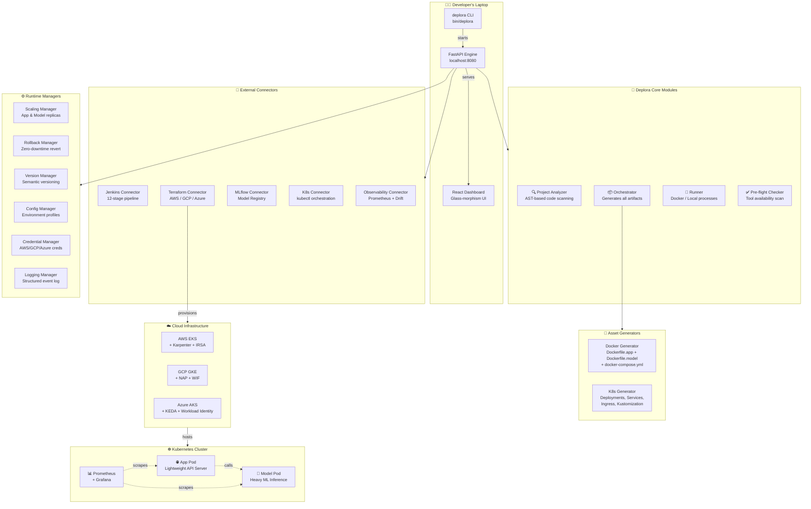
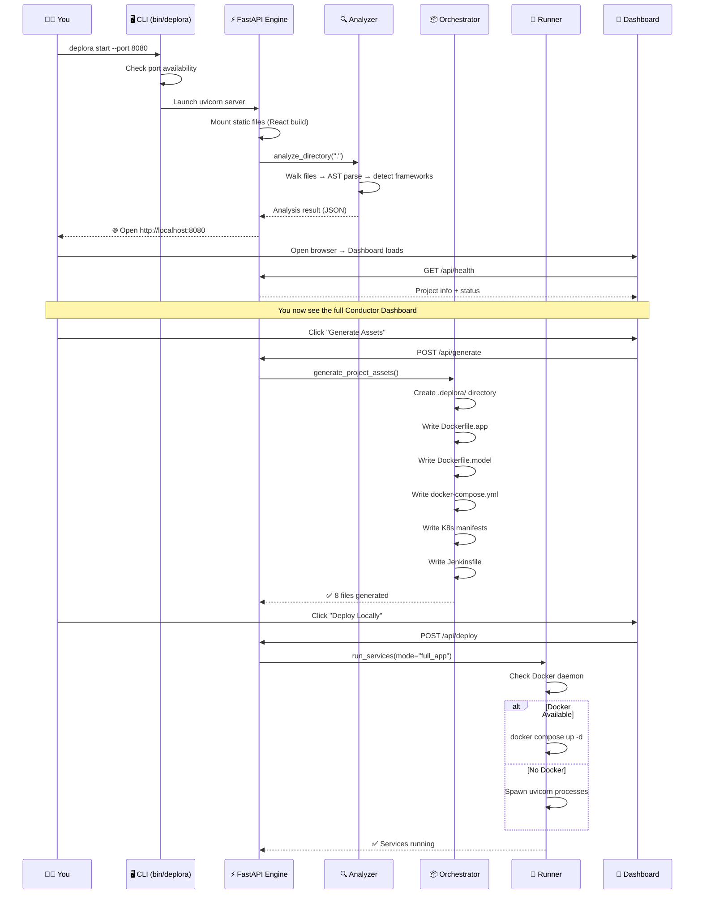

<p align="center">
  
</p>

<h1 align="center">🎼 Deplora</h1>

<p align="center">
  <strong>The MLOps Conductor — From Your Terminal to Production in One Command</strong>
</p>

<p align="center">
  <em>A locally-installed CLI + Web Dashboard that orchestrates Docker, Jenkins, Terraform, Kubernetes,<br/>MLflow & Prometheus to deploy your ML application to any cloud. Think "Jenkins for MLOps."</em>
</p>

<p align="center">
  <a href="#-quick-start"></a>
  <a href="#-how-it-works-the-simple-version"></a>
  <a href="#-complete-architecture"></a>
  <a href="#-cli-reference"></a>
  
  
  
</p>

---

## 📌 What is Deplora?

> **In one sentence:** Deplora is a tool you install locally that reads your ML project, splits it into production-ready microservices, and deploys everything to the cloud — without you writing a single Dockerfile, Kubernetes manifest, or CI/CD pipeline.

**The problem every ML developer faces:**

You built a great ML model. It works on your laptop. Now you need to get it into production. That means:

- ❌ Writing Dockerfiles (one for the app, one for the model)
- ❌ Creating Kubernetes deployment manifests
- ❌ Setting up a CI/CD pipeline (Jenkins, GitHub Actions)
- ❌ Configuring Terraform for cloud infrastructure (AWS/GCP/Azure)
- ❌ Setting up monitoring, logging, and auto-scaling
- ❌ Implementing rollback strategies

**This takes days or weeks.** Most ML engineers are not DevOps experts.

**Deplora does all of this in minutes:**

```
deplora start
```

That's it. Deplora analyzes your project, generates everything, and gives you a beautiful dashboard to control it all.

---

## 🎬 How It Works (The Simple Version)

```
  YOU                           DEPLORA                         CLOUD
  ───                           ───────                         ─────

  ┌──────────┐    deplora     ┌───────────────┐              ┌──────────────┐
  │ Your ML  │───start───────►│ 🔍 Analyze    │              │   AWS EKS    │
  │ Project  │                │ 📦 Generate   │──deploy──►   │   GCP GKE    │
  │ (Python) │   localhost    │ 🚀 Deploy     │              │  Azure AKS   │
  └──────────┘◄───8080────────│ 📊 Dashboard  │              └──────────────┘
                              └───────────────┘
```

### Three Steps. That's All.

| Step | What Happens | Time |
|:----:|:-------------|:----:|
| **① Start** | Run `deplora start` in your project folder | 2 sec |
| **② Analyze** | Deplora reads your Python files using AST parsing — detects frameworks, models, routes | instant |
| **③ Deploy** | Click "Deploy" in the dashboard — Deplora generates Docker + K8s + Jenkins + Terraform and deploys | ~5 min |

### What Deplora Detects Automatically

| What | How | Examples |
|------|-----|---------|
| **Backend Framework** | Reads import statements via Python AST | FastAPI, Flask, Django |
| **ML Libraries** | Scans `import` and `requirements.txt` | scikit-learn, PyTorch, TensorFlow |
| **Model Files** | Finds serialized model artifacts in your project | `.pkl`, `.pt`, `.h5`, `.onnx` |
| **API Routes** | Parses decorator patterns (`@app.get`, `@app.post`) | `/predict`, `/health`, `/train` |
| **Dependencies** | Reads `requirements.txt`, `pyproject.toml`, `setup.py` | All Python packages |
| **Entrypoints** | Identifies main application file | `app.py`, `main.py`, `server.py` |

---

## 🏗️ Complete Architecture

This section explains every piece of Deplora in detail. Read top-to-bottom for the full picture.

### High-Level Overview



---

### 🔬 The Core Engine — What Runs On Your Laptop

When you run `deplora start`, here's exactly what happens inside:



---

### 🧩 The Decoupled Microservice Architecture

> **This is Deplora's key innovation.** Instead of deploying your ML app as one monolith, Deplora automatically splits it into two independently scalable microservices.

```
  Traditional (Monolith)              Deplora (Decoupled)
  ─────────────────────               ──────────────────────

  ┌─────────────────────┐            ┌──────────────┐    ┌──────────────┐
  │   Your ML App       │            │   App Pod    │    │  Model Pod   │
  │                     │            │              │    │              │
  │  ┌───────────────┐  │            │  FastAPI     │    │  Inference   │
  │  │  API Routes   │  │    ──►     │  API Server  │───►│  Server      │
  │  │  + ML Model   │  │            │  (Lightweight│    │  (Heavy GPU  │
  │  │  + Everything │  │            │   ~200MB)    │    │   ~2-5GB)    │
  │  └───────────────┘  │            └──────┬───────┘    └──────┬───────┘
  │  🐌 ~3GB, slow     │                   │                   │
  │     to scale        │             Scale to 10        Scale to 3
  └─────────────────────┘             replicas fast      replicas (GPU)
```

**Why this matters:**

| Aspect | Monolith | Deplora (Decoupled) |
|--------|----------|---------------------|
| **Scaling** | Scale entire app (wasteful — GPUs for API routes?) | Scale API & Model independently |
| **Updates** | Redeploy everything for a model change | Update model pod only — zero API downtime |
| **Resources** | 3-5 GB single container | App: ~200MB + Model: ~2GB (separate) |
| **Rollback** | Roll back entire application | Roll back model only, keep API stable |
| **Cost** | GPU allocated to API endpoints too | GPU only for inference pod |

### Three Deployment Modes

```
  ┌─────────────────────────────────────────────────────────────────┐
  │                    DEPLOYMENT MODES                             │
  ├─────────────────┬─────────────────────┬─────────────────────────┤
  │   full_app      │     model_only      │      app_only           │
  │                 │                     │                         │
  │  ┌─────┐ ┌───┐ │         ┌───┐       │  ┌─────┐               │
  │  │ App │→│ M │ │         │ M │       │  │ App │               │
  │  └─────┘ └───┘ │         └───┘       │  └─────┘               │
  │                 │                     │                         │
  │  Deploy both    │  ML model           │  API server only       │
  │  services       │  inference only     │  (use existing model)  │
  └─────────────────┴─────────────────────┴─────────────────────────┘
```

---

### 🏭 The 12-Stage CI/CD Pipeline

Deplora auto-generates a Jenkinsfile with a battle-tested 12-stage pipeline:

```mermaid
flowchart LR
    S1["1️⃣<br/>AST<br/>Scan"]
    S2["2️⃣<br/>Unit<br/>Tests"]
    S3["3️⃣<br/>Decouple<br/>Services"]
    S4["4️⃣<br/>Build<br/>App Image"]
    S5["5️⃣<br/>Build<br/>Model Image"]
    S6["6️⃣<br/>Security<br/>Scan"]
    S7["7️⃣<br/>Push to<br/>Registry"]
    S8["8️⃣<br/>Terraform<br/>Apply"]
    S9["9️⃣<br/>K8s<br/>Deploy"]
    S10["🔟<br/>Health<br/>Check"]
    S11["1️⃣1️⃣<br/>Canary<br/>Shift"]
    S12["1️⃣2️⃣<br/>Active<br/>Telemetry"]

    S1 --> S2 --> S3 --> S4 --> S5 --> S6
    S6 --> S7 --> S8 --> S9 --> S10 --> S11 --> S12

    style S1 fill:#1E3A5F,stroke:#3B82F6,color:#fff
    style S2 fill:#1E3A5F,stroke:#3B82F6,color:#fff
    style S3 fill:#2D1B4E,stroke:#7C3AED,color:#fff
    style S4 fill:#2D1B4E,stroke:#7C3AED,color:#fff
    style S5 fill:#2D1B4E,stroke:#7C3AED,color:#fff
    style S6 fill:#3B1818,stroke:#EF4444,color:#fff
    style S7 fill:#1B3B2D,stroke:#10B981,color:#fff
    style S8 fill:#1B3B2D,stroke:#10B981,color:#fff
    style S9 fill:#1B3B2D,stroke:#10B981,color:#fff
    style S10 fill:#3B3518,stroke:#F59E0B,color:#fff
    style S11 fill:#3B3518,stroke:#F59E0B,color:#fff
    style S12 fill:#3B3518,stroke:#F59E0B,color:#fff
```



| Stage | What It Does |
|:-----:|:-------------|
| **1. AST Scan** | Statically analyzes your Python source code using Python's `ast` module |
| **2. Unit Tests** | Runs `pytest` to validate model accuracy and API contracts |
| **3. Decouple** | Splits your monolith into App + Model microservices |
| **4. Build App** | Creates a lightweight Docker image for the API server |
| **5. Build Model** | Creates a GPU-ready Docker image for the inference server |
| **6. Security Scan** | Runs Trivy to scan both images for CVEs |
| **7. Push Registry** | Pushes images to ECR/GCR/ACR container registry |
| **8. Terraform** | Provisions cloud infrastructure (EKS/GKE/AKS) if needed |
| **9. K8s Deploy** | Applies Kubernetes manifests to the cluster |
| **10. Health Check** | Validates all pods are healthy and endpoints respond |
| **11. Canary Shift** | Gradually shifts traffic 10% → 50% → 100% to new version |
| **12. Telemetry** | Activates Prometheus scraping + drift detection monitoring |

---

### ☁️ Multi-Cloud Support

Deploy the same project to any major cloud with zero config changes:

```
                        ┌─────────────────────────────────┐
                        │       deplora deploy             │
                        │    --cloud aws|gcp|azure         │
                        └──────────┬──────────────────────┘
                                   │
              ┌────────────────────┼────────────────────┐
              ▼                    ▼                     ▼
     ┌────────────────┐  ┌────────────────┐   ┌────────────────┐
     │   AWS (EKS)    │  │   GCP (GKE)    │   │  Azure (AKS)   │
     │                │  │                │   │                │
     │ • Karpenter    │  │ • Node Auto-   │   │ • KEDA         │
     │   autoscaler   │  │   provisioning │   │   autoscaler   │
     │ • IRSA for     │  │ • Workload     │   │ • Workload     │
     │   pod identity │  │   Identity Fed │   │   Identity     │
     │ • S3 artifacts │  │ • GCS artifacts│   │ • Blob storage │
     │ • RDS Postgres │  │ • Cloud SQL    │   │ • Flex Postgres│
     │ • ECR registry │  │ • Artifact Reg │   │ • ACR registry │
     │ • ALB Ingress  │  │ • NGINX Ingress│   │ • NGINX Ingress│
     └────────────────┘  └────────────────┘   └────────────────┘
```

| Feature | AWS (EKS) | GCP (GKE) | Azure (AKS) |
|---------|:---------:|:---------:|:------------:|
| GPU Autoscaling | Karpenter | NAP | KEDA |
| Pod Identity | IRSA | WIF | Workload Identity |
| Model Storage | S3 | GCS | Blob Storage |
| Metadata DB | RDS PostgreSQL | Cloud SQL | Flexible PostgreSQL |
| Container Registry | ECR | Artifact Registry | ACR |
| Ingress | ALB Controller | NGINX | NGINX |
| Secrets | SSM + External Secrets | Secret Manager | Key Vault |
| Network Logs | VPC Flow Logs | VPC Flow Logs | NSG Flow Logs |
| Est. Dev Cost | ~\$350-450/mo | ~\$200-350/mo | ~\$260-330/mo |

> All Terraform HCL is pre-built under `infrastructure/terraform/` with `dev` and `prod` environment configs for each cloud.

---

## 🚀 Quick Start

### Prerequisites

| Tool | Required | Why |
|------|:--------:|-----|
| **Python 3.12+** | ✅ | Deplora engine runtime |
| **uv** (or pip) | ✅ | Dependency management |
| **Node.js 18+** | For UI dev | Dashboard build (pre-built included) |
| **Docker** | Optional | Local container deployment |
| **Terraform** | Optional | Cloud infrastructure provisioning |
| **kubectl** | Optional | Kubernetes cluster management |

### Install & Run

```bash
# 1. Clone the repository
git clone https://github.com/sathvikvelapaka/deplora.git
cd deplora

# 2. Install Python dependencies
uv sync          # or: pip install -e .

# 3. Launch Deplora
./bin/deplora start --port 8080
```

That's it! Your browser opens to `http://localhost:8080` with the full dashboard.

### Your First Deploy

```bash
# Point Deplora at any ML project
cd /path/to/your/ml-project
deplora start

# Or use CLI commands directly:
deplora check      # Pre-flight: verify Docker, kubectl, etc.
deplora analyze    # Scan your project
deplora generate   # Create Dockerfiles, K8s manifests, Jenkinsfile
deplora build      # Build Docker images
deplora deploy     # Deploy to Kubernetes
deplora status     # Check what's running
deplora logs       # View real-time logs
```

---

## 🖥️ The Dashboard

Deplora ships with a glass-morphism dark-themed React dashboard with **7 tabs**:

| Tab | What It Shows |
|-----|---------------|
| **📖 Guide** | Interactive walkthrough with Beginner → Intermediate → Advanced sub-tabs, CLI reference, and FAQ |
| **🎼 Conductor Studio** | Full orchestration control — analyze, generate, build, deploy, rollback from one panel |
| **🔄 Pipeline Flow** | Visual 12-stage CI/CD pipeline with real-time stage status |
| **☸️ Active Pods & Canary** | Live pod status, canary traffic split visualization, replica counts |
| **🌐 Multi-Cloud K8s** | Cloud comparison dashboard — AWS/GCP/Azure infrastructure status |
| **📊 Services & Metrics** | Prometheus telemetry, request latency, model drift detection |
| **🏠 All-In-One** | Unified view combining all panels on a single page |

> No login required. Deplora is a local tool — the dashboard runs on your laptop.

---

## 📟 CLI Reference

| Command | Description | Example |
|---------|-------------|---------|
| `deplora start` | Launch engine + dashboard | `deplora start --port 8080` |
| `deplora check` | Pre-flight tool check (Docker, kubectl, Terraform, Helm) | `deplora check` |
| `deplora analyze` | AST-scan the current directory for frameworks & models | `deplora analyze` |
| `deplora generate` | Generate Docker, K8s, Jenkins, MLflow assets in `.deplora/` | `deplora generate` |
| `deplora build` | Build Docker images for App + Model | `deplora build` |
| `deplora deploy` | Deploy to Kubernetes (or local Docker Compose) | `deplora deploy --mode full_app` |
| `deplora scale` | Scale app or model replicas | `deplora scale --target model --replicas 5` |
| `deplora test` | Run inference test against deployed model | `deplora test --input "test data"` |
| `deplora logs` | Stream structured logs from all services | `deplora logs --follow` |
| `deplora rollback` | Zero-downtime rollback to last stable version | `deplora rollback --target model` |
| `deplora status` | Show running services, pods, versions | `deplora status` |
| `deplora stop` | Gracefully stop all services | `deplora stop` |

---

## 🗂️ Project Structure

```
deplora/
├── bin/
│   └── deplora                      # 🚀 CLI launcher (bash wrapper)
├── deplora/                         # 🧠 Core Python engine
│   ├── cli.py                       #    CLI entrypoint & argument parser
│   ├── engine.py                    #    FastAPI server (REST API + static files)
│   ├── analyzer.py                  #    AST-based project scanner
│   ├── orchestrator.py              #    Master asset generation engine
│   ├── runner.py                    #    Docker / local process runner
│   ├── checker.py                   #    Pre-flight tool checker
│   ├── scaling.py                   #    Horizontal pod autoscaler
│   ├── rollback.py                  #    Zero-downtime rollback engine
│   ├── versioning.py                #    Semantic version manager
│   ├── config.py                    #    Environment config manager
│   ├── credentials.py               #    Cloud credential manager
│   ├── logging_manager.py           #    Structured event logger
│   ├── generators/
│   │   ├── docker.py                #    Dockerfile + docker-compose generator
│   │   └── k8s.py                   #    K8s manifest generator
│   └── connectors/
│       ├── jenkins.py               #    Jenkins CI/CD connector
│       ├── terraform.py             #    Multi-cloud Terraform connector
│       ├── mlflow.py                #    MLflow model registry connector
│       ├── k8s.py                   #    Kubernetes workload connector
│       └── observability.py         #    Prometheus + drift detection
├── components/
│   └── dashboard-ui/                # 🎨 React + Vite dashboard
│       └── src/components/
│           ├── ConductorControl.jsx #    Main orchestration panel
│           ├── GuideWalkthrough.jsx  #    5-tab interactive guide
│           ├── Sidebar.jsx          #    Navigation sidebar
│           ├── Header.jsx           #    Top bar with status
│           ├── MetricsChart.jsx     #    Telemetry visualizations
│           ├── MetricWidget.jsx     #    Individual metric cards
│           ├── ToolCard.jsx         #    Tool status cards
│           ├── ProgressBar.jsx      #    Pipeline progress bar
│           └── ErrorBoundary.jsx    #    React error catch wrapper
├── infrastructure/
│   ├── terraform/
│   │   ├── modules/
│   │   │   ├── eks/                 #    AWS EKS Terraform module
│   │   │   ├── aks/                 #    Azure AKS Terraform module
│   │   │   └── gke/                 #    GCP GKE Terraform module
│   │   ├── environments/
│   │   │   ├── aws/{dev,prod}/      #    AWS env configs
│   │   │   ├── azure/{dev,prod}/    #    Azure env configs
│   │   │   └── gcp/{dev,prod}/      #    GCP env configs
│   │   └── bootstrap/{aws,azure,gcp}/ # Cloud bootstrap (OIDC, storage)
│   ├── helm/{common,aws,azure,gcp}/ #   Helm value overrides
│   └── grafana/dashboards/          #    Grafana dashboard JSON
├── pipelines/
│   ├── training/                    #    Iris ML training pipeline (Argo)
│   └── pretrained/                  #    HuggingFace model pipeline
├── examples/
│   ├── kserve/                      #    KServe inference examples
│   ├── canary-deployment/           #    Progressive rollout example
│   ├── distributed-training/        #    PyTorch DDP example
│   ├── llm-inference/               #    vLLM GPU serving example
│   ├── chaos-testing/               #    Chaos Mesh resilience tests
│   └── load-testing/                #    k6 + Locust load tests
├── tests/                           # 🧪 270+ passing tests
│   ├── unit/                        #    Module-level unit tests
│   ├── integration/                 #    Cross-module integration tests
│   ├── property/                    #    Hypothesis property-based tests
│   ├── e2e/                         #    End-to-end K8s cluster tests
│   └── policies/                    #    Kyverno policy tests
├── docs/                            # 📚 Documentation
│   ├── GETTING_STARTED.md           #    Beginner-to-advanced walkthrough
│   ├── architecture.md              #    Architecture deep dive
│   └── adr/                         #    Architecture Decision Records
├── scripts/                         # 🔧 Deploy & destroy scripts
│   ├── deploy-{aws,azure,gcp}.sh
│   └── destroy-{aws,azure,gcp}.sh
├── pyproject.toml                   #    Python project config (hatchling)
├── Makefile                         #    Common operations
└── README.md                        #    ← You are here
```

---

## 🛠️ Tech Stack

### Deplora Engine

| Component | Technology | Purpose |
|-----------|------------|---------|
| **CLI** | Python + argparse | Developer-facing command interface |
| **Engine** | FastAPI + Uvicorn | REST API server & static file server |
| **Analyzer** | Python `ast` module | Zero-dependency source code parsing |
| **Dashboard** | React 18 + Vite | Glass-morphism dark-themed control panel |
| **Icons** | Lucide React | Consistent icon system |
| **Package Manager** | uv (hatchling) | Fast Python dependency resolution |

### Infrastructure & DevOps

| Component | Technology | Purpose |
|-----------|------------|---------|
| **Containers** | Docker + Docker Compose | Local development & image building |
| **Orchestration** | Kubernetes (K8s) | Production container orchestration |
| **CI/CD** | Jenkins (auto-generated) | 12-stage deployment pipeline |
| **IaC** | Terraform (HCL) | Multi-cloud infrastructure provisioning |
| **GitOps** | ArgoCD | Declarative Kubernetes deployments |
| **Ingress** | AWS ALB / NGINX | External traffic routing |

### ML Platform

| Component | Technology | Purpose |
|-----------|------------|---------|
| **Experiment Tracking** | MLflow | Model versioning, metrics, artifacts |
| **Model Serving** | KServe | Production inference (CNCF Incubating) |
| **Training Pipelines** | Argo Workflows | ML workflow orchestration |
| **Model Formats** | `.pkl` `.pt` `.h5` `.onnx` | Scikit-learn, PyTorch, TensorFlow, ONNX |

### Observability & Security

| Component | Technology | Purpose |
|-----------|------------|---------|
| **Metrics** | Prometheus + Grafana | Application & model telemetry |
| **Logging** | Loki + Grafana Alloy | Centralized log aggregation |
| **Tracing** | Tempo + OpenTelemetry | Distributed request tracing |
| **Drift Detection** | Statistical analysis | Monitors model input/output drift |
| **Security** | Kyverno + Tetragon | Policy-as-code + eBPF runtime security |
| **Secrets** | External Secrets Operator | Cloud secrets sync (SSM/KV/SecretManager) |
| **Chaos Engineering** | Chaos Mesh | Resilience testing |

---

## 🧪 Testing

Deplora has **270+ tests** across multiple testing strategies:

```bash
# Run all tests
uv run pytest

# Run specific test categories
uv run pytest tests/unit/              # Unit tests
uv run pytest tests/integration/       # Integration tests
uv run pytest tests/property/          # Property-based tests (Hypothesis)
uv run pytest tests/e2e/ -m "not e2e"  # E2E tests (requires K8s cluster)
```

| Test Type | Count | What It Covers |
|-----------|:-----:|----------------|
| **Unit** | ~180 | Individual modules: analyzer, generators, connectors, scaling, rollback |
| **Integration** | ~40 | Cross-module flows: analyze → generate → deploy pipeline |
| **Property** | ~30 | Randomized input testing with Hypothesis for drift detection, schema validation |
| **E2E** | ~8 | Full Kubernetes deployment tests (requires live cluster) |
| **Policy** | ~12 | Kyverno policy validation for model registry governance |

---

## 🔄 What's Real vs. Emulated

> Transparency: Deplora works fully offline. Some features simulate cloud state when you're not connected.

| Feature | Status | Details |
|---------|:------:|---------|
| **AST Code Parsing** | ✅ Real | Reads and analyzes your actual Python files |
| **Asset Generation** | ✅ Real | Creates actual Dockerfiles, K8s manifests, Jenkinsfiles on disk |
| **Model Inference** | ✅ Real | Loads `.pkl` models with `pickle.load()` and runs `model.predict()` |
| **Docker Compose** | ✅ Real | Runs actual containers when Docker daemon is available |
| **Process Management** | ✅ Real | Spawns/kills real uvicorn processes with PID tracking |
| **React Dashboard** | ✅ Real | Full interactive UI served from FastAPI static mount |
| **REST API** | ✅ Real | All endpoints return live data from the engine |
| **Cloud Deploy Status** | ⚡ Emulated | Shows simulated cluster state when no cloud credentials |
| **Jenkins Pipeline** | ⚡ Emulated | Shows pipeline progress UI when Jenkins isn't running |
| **Drift Telemetry** | ⚡ Emulated | Generates realistic metric streams when no live traffic |

---

## ❓ FAQ

<details>
<summary><b>Do I need Docker to use Deplora?</b></summary>

No. If Docker isn't running, Deplora falls back to spawning isolated Python processes locally. Docker is needed only for building production container images.
</details>

<details>
<summary><b>Do I need a Kubernetes cluster?</b></summary>

Not for local development. Deplora generates all K8s manifests locally and can deploy to Docker Compose for testing. You need a cluster only for actual cloud deployment.
</details>

<details>
<summary><b>What ML frameworks are supported?</b></summary>

Deplora detects **scikit-learn**, **PyTorch**, **TensorFlow/Keras**, and **ONNX** models. It recognizes `.pkl`, `.pt`, `.h5`, and `.onnx` model files. Backend frameworks: **FastAPI**, **Flask**, **Django**.
</details>

<details>
<summary><b>Can I use Deplora with an existing project?</b></summary>

Yes! Just `cd` into your project directory and run `deplora start`. The analyzer scans your existing code — no changes needed. Generated assets go into a `.deplora/` subdirectory.
</details>

<details>
<summary><b>Is there a login or authentication?</b></summary>

No. Deplora runs entirely on your laptop. The dashboard is served locally — no accounts, no cloud dependency, no telemetry sent anywhere.
</details>

<details>
<summary><b>What if the default port is busy?</b></summary>

Deplora auto-detects port conflicts and falls back to the next available port (8080 → 8090 → 8091...). You can also specify: `deplora start --port 9000`.
</details>

<details>
<summary><b>How is this different from Kubeflow or SageMaker?</b></summary>

Kubeflow and SageMaker are cloud platforms you deploy *to*. Deplora is a local tool that *generates everything for you* and then deploys to any cloud. It's the layer between your code and those platforms.
</details>

---

## 📊 Comparison with Alternatives

| | **Deplora** | Kubeflow | SageMaker | Vertex AI |
|--|:-----------:|:--------:|:---------:|:---------:|
| **Runs Locally** | ✅ | ❌ | ❌ | ❌ |
| **Multi-Cloud** | ✅ AWS/GCP/Azure | ❌ | ❌ AWS only | ❌ GCP only |
| **Auto-Generates Assets** | ✅ Docker+K8s+Jenkins | ❌ | ❌ | ❌ |
| **Decouples App/Model** | ✅ Automatic | ❌ Manual | ❌ | ❌ |
| **Open Source** | ✅ MIT | ✅ Apache 2.0 | ❌ Proprietary | ❌ Proprietary |
| **No DevOps Expertise** | ✅ | ❌ High curve | ✅ Managed | ✅ Managed |
| **Cost (Dev)** | \$0 (local) | Variable | \$\$\$ | \$\$\$ |
| **Vendor Lock-in** | ✅ None | ✅ None | ❌ AWS | ❌ GCP |

---

## 🗺️ Roadmap

### ✅ Completed

- [x] Core engine — CLI, FastAPI server, React dashboard
- [x] AST-based project analyzer with framework detection
- [x] Automatic Dockerfile, K8s manifest, and Jenkinsfile generation
- [x] Decoupled App/Model microservice architecture
- [x] 3 deployment modes: `full_app`, `model_only`, `app_only`
- [x] 12-stage Jenkins CI/CD pipeline generation
- [x] Multi-cloud Terraform (AWS EKS, GCP GKE, Azure AKS)
- [x] MLflow model registry integration
- [x] Scaling, rollback, and version management
- [x] 270+ automated tests (unit, integration, property, e2e)
- [x] Glass-morphism dashboard with 7 interactive tabs
- [x] Interactive guide with beginner-to-advanced walkthrough

### 🔄 In Progress

- [ ] End-to-end live cluster verification (deploy → canary → auto-rollback)
- [ ] ArgoCD GitOps-driven promotion (dev → staging → prod)
- [ ] GPU-verified LLM inference benchmarks

### 🔮 Future

- [ ] A/B testing framework for model comparison
- [ ] Feature store integration (Feast)
- [ ] Model explainability dashboards (SHAP/LIME)
- [ ] Plugin system for custom connectors
- [ ] `deplora init` project scaffolding wizard

---

## 📄 Documentation

| Guide | Description |
|-------|-------------|
| [**Getting Started**](docs/GETTING_STARTED.md) | Step-by-step from install to first deploy |
| [**Architecture Deep Dive**](docs/architecture.md) | Full system design and component details |
| [**API Reference**](docs/api-reference.md) | REST API endpoint documentation |
| [**Operations Runbook**](docs/runbooks/operations.md) | Day-to-day operations procedures |
| [**Troubleshooting**](docs/runbooks/troubleshooting.md) | Common issues and fixes |
| [**Performance Tuning**](docs/performance-tuning.md) | Optimize inference and training workloads |
| [**Disaster Recovery**](docs/disaster-recovery.md) | Backup and recovery procedures |
| [**Secrets Management**](docs/secrets-management.md) | Credential rotation and security |
| [**ADR Index**](docs/adr/) | Architecture Decision Records |

---

## 📜 License

MIT License — see [LICENSE](LICENSE) for details.

---

<p align="center">
  <strong>Built with 🎼 by</strong>
</p>

<h3 align="center">Sathvik Velapaka</h3>

<p align="center">
  <em>DevOps & MLOps Engineer · Cloud-Native AI Infrastructure</em>
</p>

<p align="center">
  <a href="https://judaire.io"></a>
  <a href="https://linkedin.com/in/sathvikvelapaka"></a>
  <a href="https://github.com/sathvikvelapaka"></a>
</p>

<p align="center">
  <sub>⭐ Star this repo if Deplora saves you from YAML hell ⭐</sub>
</p>
